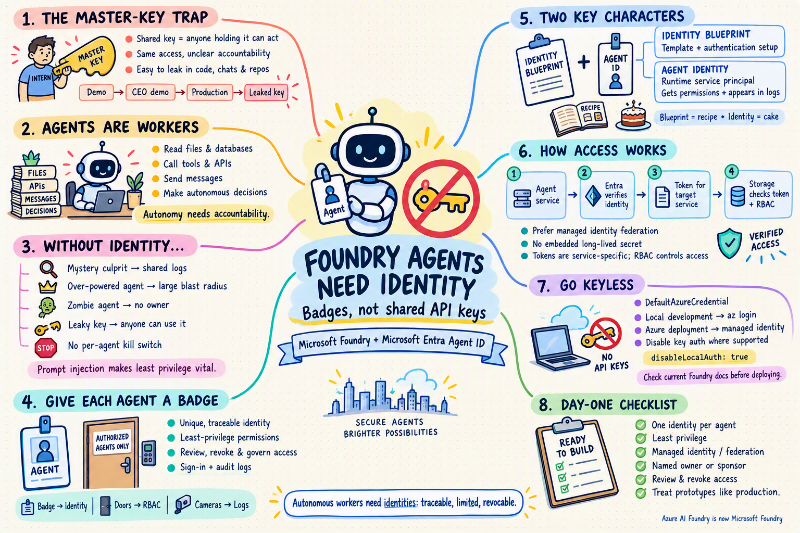

# 🤖🔑 Why Foundry Agents Need an Identity, Not Just an API Key

> *Part 1 of 4 in the series: **Securing Microsoft Foundry Agents with Microsoft Entra ID***

  

---


## 🎬 The Hook: The Intern With the Master Key

Imagine you hire a brand-new intern. 🧑‍💼 They are enthusiastic, they work 24/7, they never take a coffee break, and they occasionally make things up with great confidence.

Now imagine your onboarding process is this:

1. Photocopy the **master key** to the whole building 🗝️
2. Hand it to the intern
3. Say "be good!" 🙏

Sounds ridiculous, right? Yet this is exactly what happens when we build AI agents with a **shared API key** and call it a day.

In this post, we'll learn **why Microsoft Foundry agents deserve a real identity** (a proper employee badge 🪪) and how **Microsoft Entra ID** gives them one.

> 📝 **Quick note:** Azure AI Foundry is now called **Microsoft Foundry**. Same family, shinier name. ✨

---

## ⚡ TL;DR (For the Busy Humans)

| ❌ API Key | ✅ Entra Identity |
|---|---|
| Anyone holding it can use it | Tied to a specific agent |
| Hard to tell *who* did something | Every action is traceable 🔍 |
| Often never expires | Can expire, be reviewed, be revoked |
| Same access for everything | Least-privilege, per agent |
| Leaks in a Git repo = bad day 😱 | No secret to leak (with the right setup) |

**Bottom line:** An agent can read data, call tools and take actions. That makes it a **worker**, and workers need **badges**, not photocopied keys.

---

## 😰 The Problem: "It's Just a Prototype" (Famous Last Words)

Every agent project starts innocently:

```text
Day 1:   "Let's just paste the key in the code. It's only a demo."
Day 30:  "Demo went well! Let's show it to the CEO."
Day 90:  "It's in production now."
Day 91:  "Why is there an API key in our GitHub repo?" 🔥
```

An agent isn't a simple chatbot anymore. Modern agents can:

- 📂 Read files and databases
- 🔌 Call tools and APIs
- 📧 Send messages
- 🧠 Decide what to do *on their own*

That last one is the important part. Agents are **autonomous**. They make decisions you didn't write line by line.

---

## 😱 Agitate: What Goes Wrong Without Identity?

Let's play the "What Could Possibly Go Wrong?" game 🎲

### 1. 🕵️ The Mystery Culprit
Five agents share one key. Something weird happens in your data. Which agent did it? 🤷 Nobody knows. The logs just say "the key did it."

### 2. 👑 The Over-Powered Agent
To make things "just work," someone gives the agent broad access to everything. Now a single confused (or tricked) agent can reach far more than it should. Remember, agents can be manipulated through **prompt injection**, so a smaller blast radius matters. 💥

### 3. 🧟 The Zombie Agent
The project ended 8 months ago. The agent didn't. It's still running, still has access, and nobody remembers who owns it. 👻

### 4. 🔓 The Leaky Key
Keys get pasted into chats, committed to repos and forgotten in config files. Once it leaks, **anyone** can use it, from anywhere, at any time.

### 5. 🚪 No Kill Switch
Something looks wrong. Can you instantly shut down just that one agent without breaking the others? With a shared key... not really. 😬

---

## 🦸 The Solution: Give Your Agent a Badge (Entra Agent ID)

**Microsoft Entra ID** is Microsoft's identity service, the same system that already handles sign-ins for your employees. 🏢

Entra now supports a special concept for AI agents, called **Microsoft Entra Agent ID**. Agents become *first-class citizens* in your directory, so you can see them, control them and govern them the same way you do people. Agents created in Foundry are registered for you automatically, so you don't have to build this from scratch. 🎉

### 🏢 The Office Building Analogy

Let's map everything to a building:

| Real-world office 🏢 | Entra world 🔐 |
|---|---|
| Master key under the doormat | API key |
| Employee badge with photo and name | **Agent identity** |
| HR's "role template" for a job type | **Agent identity blueprint** |
| Badge only opens certain doors | **RBAC role assignments** |
| Badge expires or gets deactivated | Lifecycle governance and revocation |
| Security cameras and door logs 📹 | Sign-in and audit logs |
| "Suspicious badge swipe at 3 AM" alert 🚨 | Conditional Access and Identity Protection |

---

## 🧩 Meet the Two Key Characters

### 1️⃣ Agent Identity Blueprint 📋
Think of it as the **job description and onboarding paperwork**. It's the template that agent identities are created from, and it holds the credentials used to authenticate to Entra.

### 2️⃣ Agent Identity 🪪
This is the **actual badge**. Technically, it's a special kind of service principal in Entra ID that represents your agent while it runs. It's what gets assigned permissions and shows up in your logs.

> 🧠 **Remember it like this:** The *blueprint* is the recipe 📖, the *agent identity* is the cake 🍰.

---

## 🔄 How Does It Work? (The Simple Version)

When your agent needs to talk to something (say, Azure Storage), this happens behind the scenes:

```text
1. 🤖 Agent Service:   "Hi Entra, here's the blueprint's proof of identity."
2. 🛡️ Entra ID:        "Checks out! Here's a token for this agent identity."
3. 🤖 Agent Service:   "Please give me a token for Azure Storage only."
4. 🛡️ Entra ID:        "Done. This token is scoped to that one service."
5. 📦 Azure Storage:   "Valid token, and RBAC says this agent may read. Come in!"
```

Notice what's **missing**? 🥁 There's no long-lived secret floating around in your code. With the recommended setup (federating with a managed identity), you don't even need a client secret or certificate. Nothing to leak. Nothing to rotate. Nothing to paste into Slack. 🎤⬇️

---

## 💻 Show Me the Code!

### ❌ The "Please Hack Me" Way

```python
# 🚨 Don't do this. Seriously. Your future self will cry.
from azure.ai.projects import AIProjectClient

client = AIProjectClient(
    endpoint="https://my-foundry.services.ai.azure.com/api/projects/my-project",
    api_key="sk-super-secret-key-pls-dont-leak"  # 😱 hardcoded secret
)
```

### ✅ The Entra ID Way

```python
# ✨ No secrets in code. Identity does the work.
from azure.identity import DefaultAzureCredential
from azure.ai.projects import AIProjectClient

client = AIProjectClient(
    endpoint="https://my-foundry.services.ai.azure.com/api/projects/my-project",
    credential=DefaultAzureCredential(),  # 🪪 uses your Entra identity
)
```

`DefaultAzureCredential` is smart. On your laptop it uses your `az login` session, and in Azure it uses a managed identity. **Same code, zero secrets.** 🪄

### 🔒 Bonus: Turn Off Key Access Completely

You can tell your Foundry resource to **stop accepting keys** and allow Entra ID only. In Bicep, that's one line:

```bicep
resource foundry 'Microsoft.CognitiveServices/accounts@2025-06-01' = {
  name: 'my-foundry-resource'
  location: resourceGroup().location
  kind: 'AIServices'
  sku: { name: 'S0' }
  properties: {
    customSubDomainName: 'my-foundry-resource'
    disableLocalAuth: true   // 🚫 API keys stop working. Entra ID only!
  }
}
```

> ⚠️ API versions and properties evolve quickly. Check the latest Foundry docs for the current version before deploying.

It's the equivalent of **changing the locks** and handing out personalized badges. 🔐

---

## 🏆 Quick Best Practices Checklist

- ✅ Use **Entra ID** authentication instead of API keys
- ✅ Give each agent its **own identity** (no sharing!)
- ✅ Follow **least privilege**: give the agent only the roles it needs
- ✅ Prefer **managed identity / federated credentials** over client secrets
- ✅ Assign an **owner/sponsor** so no agent becomes a zombie 🧟
- ✅ **Disable local (key) auth** where possible
- ✅ Treat an "it's just a prototype" agent like a production one 😉

---

## 🧠 Key Takeaways

1. 🤖 Agents are **autonomous workers**, not just chat windows.
2. 🔑 API keys are like **photocopied master keys**: powerful, anonymous and easy to leak.
3. 🪪 Entra Agent ID gives every agent a **badge**: traceable, limited and revocable.
4. 🧱 **Blueprint = template, Agent identity = badge.**
5. 🚀 Starting with identity on day one saves you from painful retrofits later.

---

## 🔮 What's Next?

In **Blog 2**, we'll open the hood on **authentication and authorization**: how the token flow really works, how to pick the right credential type, and how to assign RBAC roles using least privilege. 🛠️

Stay tuned, and may your agents always have valid badges! 🪪✨

---

## 📚 References (Microsoft Docs)

- 🪪 [Agent identity concepts in Microsoft Foundry](https://learn.microsoft.com/azure/foundry/agents/concepts/agent-identity)
- 🧭 [Microsoft Entra Agent ID documentation](https://learn.microsoft.com/en-us/entra/agent-id/)
- 🎓 [Learn module: Understand the Microsoft Entra Agent ID object model](https://learn.microsoft.com/en-us/training/modules/establish-agent-identities-entra-agent-id/2-understand-agent-id-object-model)
- 📣 [Tech Community: Foundry and Entra Agent ID announcement](https://techcommunity.microsoft.com/blog/aiplatformblog/-/4415186)
- 🔐 [What are managed identities for Azure resources?](https://learn.microsoft.com/en-us/entra/identity/managed-identities-azure-resources/overview)
- 🛂 [What is Azure role-based access control (RBAC)?](https://learn.microsoft.com/en-us/azure/role-based-access-control/overview)

> 🔎 *Entra Agent ID is evolving quickly. Some features may be in preview or depend on licensing, so always verify current status in the docs above.*

---

💬 **Enjoyed this post?** Drop a ⭐ on the repo, share it with a teammate who still has API keys in their code, and join me for Blog 2!