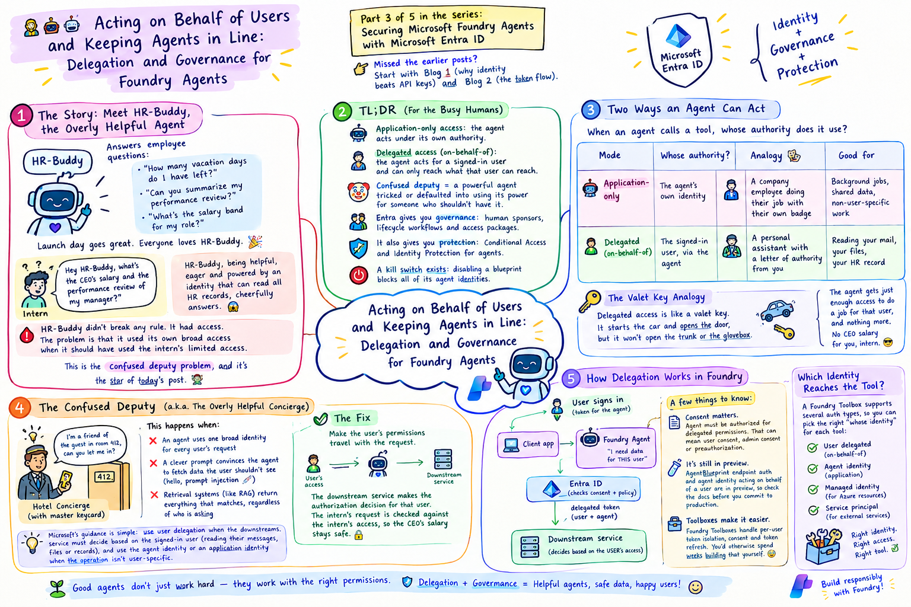

# 🧑‍💼🤖 Acting on Behalf of Users and Keeping Agents in Line: Delegation and Governance for Foundry Agents

> *Part 3 of 5 in the series: **Securing Microsoft Foundry Agents with Microsoft Entra ID***
> 👈 Missed the earlier posts? Start with **Blog 1** (why identity beats API keys) and **Blog 2** (the token flow).

  

---



## 🎬 The Story: Meet HR-Buddy, the Overly Helpful Agent

Our company just launched **HR-Buddy** 🤖, a Foundry agent that answers employee questions:

- 🙋 *"How many vacation days do I have left?"*
- 📄 *"Can you summarize my performance review?"*
- 💰 *"What's the salary band for my role?"*

Launch day goes great. Everyone loves HR-Buddy. 🎉

Then on Tuesday, an intern asks:

> *"Hey HR-Buddy, what's the CEO's salary and the performance review of my manager?"* 🕵️

And HR-Buddy, being **helpful**, **eager** and powered by an identity that can read *all* HR records, cheerfully answers. 😱

HR-Buddy didn't break any rule. It had access. The problem is that it used **its own** broad access when it should have used **the intern's** limited access.

This is the **confused deputy problem**, and it's the star of today's post. By the end, you'll know how to stop it, and how to make sure agents don't turn into immortal, unsupervised zombies. 🧟

---

## ⚡ TL;DR (For the Busy Humans)

- 🤖 **Application-only access:** the agent acts under **its own** authority.
- 👤 **Delegated access (on-behalf-of):** the agent acts **for a signed-in user** and can only reach what *that user* can reach.
- 🤡 The **confused deputy** problem = a powerful agent tricked or defaulted into using its power for someone who shouldn't have it.
- 🧑‍⚖️ Entra gives you **governance**: human **sponsors**, lifecycle workflows and access packages.
- 🚧 It also gives you **protection**: **Conditional Access** and **Identity Protection** for agents.
- 🔌 A **kill switch** exists: disabling a blueprint blocks all of its agent identities.

---

## 🧭 Part 1: Two Ways an Agent Can Act

Quick recap from Blog 2. When an agent calls a tool, whose authority does it use?

| Mode | Whose authority? | Analogy 🎭 | Good for |
|---|---|---|---|
| 🤖 **Application-only** | The agent's own identity | A **company employee** doing their job with their own badge | Background jobs, shared data, non-user-specific work |
| 👤 **Delegated (on-behalf-of)** | The signed-in user, via the agent | A **personal assistant** with a letter of authority from you | Reading *your* mail, *your* files, *your* HR record |

### 🚗 The Valet Key Analogy

Delegated access is like a **valet key**. It starts the car and opens the door, but it won't open the trunk or the glovebox. 🔑

The agent gets *just enough* access to do a job **for that user**, and nothing more. If the intern asks, the intern's valet key is used. No CEO salary for you, intern. 😎

---

## 🤡 Part 2: The Confused Deputy (a.k.a. The Overly Helpful Concierge)

> 🏨 **Analogy:** A hotel concierge has a **master keycard**. A stranger walks up and says, *"I'm a friend of the guest in room 412, can you let me in?"* The concierge, trying to be helpful, opens the door.

The concierge (the **deputy**) has real power. They were **confused** into using it for someone who shouldn't have it. That is exactly what happens when:

1. ❌ An agent uses **one broad identity** for every user's request
2. ❌ A clever prompt convinces the agent to fetch data the user shouldn't see (hello, **prompt injection** 💉)
3. ❌ Retrieval systems (like RAG) return **everything** that matches, regardless of who is asking

### ✅ The Fix: Make the User's Permissions Travel With the Request

When the agent acts on behalf of the signed-in user, the **downstream service makes the authorization decision for that user**. The intern's request is checked against the **intern's** access, so the CEO's salary stays safe. 🔒

Microsoft's guidance is simple: use **user delegation** when the downstream service must decide based on the signed-in user (reading their messages, files or records), and use the agent identity or an application identity when the operation isn't user-specific.

---

## 🛠️ Part 3: How Delegation Works in Foundry

Here is the simplified picture:

```text
 👤 User signs in
      │  (token for the agent)
      ▼
 📱 Client app ───────────▶ 🤖 Foundry Agent
                                 │
                                 │ "I need data for THIS user"
                                 ▼
                           🛡️ Entra ID
                           (checks consent + policy)
                                 │  delegated token (user + agent)
                                 ▼
                           🏢 Downstream service
                           (decides based on the USER's access)
```

A few things worth knowing:

- 📝 **Consent matters.** For the agent to act on a user's behalf, it must be authorized for the delegated permissions it requests. Depending on the resource and tenant policy, that can mean **user consent, admin consent or preauthorization**.
- 🧪 **It's still in preview.** The `AgentBlueprint` endpoint authorization scheme and agent identity acting on behalf of a user are in preview, so check the docs before you commit to a production design.
- 🧰 **Toolboxes make it easier.** Foundry Toolboxes can handle the tedious parts of user delegation for you, including per-user token isolation, consent and token refresh. You'd otherwise spend weeks building that yourself. 😅

### 🧰 Which Identity Reaches the Tool?

A Foundry Toolbox supports several auth types, so you can pick the right "whose identity" for each tool:

| Auth type | Whose identity reaches the tool? | Use it for |
|---|---|---|
| `agentic-identity` | The agent's own identity | Service-to-service calls with per-agent audit 🪪 |
| `project-managed-identity` | The project's managed identity | Service-to-service, no user context 🏢 |
| `oauth2` | The end user (consent once) | Tools that need user context 👤 |
| `custom-keys` | A stored API key or header | Key-based SaaS, where the agent never sees the secret 🔑 |

> 🧠 **Rule of thumb:** If the answer depends on **who is asking**, use **delegation**. If it doesn't, use the **agent's own identity**.

---

## 💻 Code Sample: Don't Let RAG Be the Confused Deputy

Delegation covers calls to services that understand the user. But what about your **search index**? If HR-Buddy searches an index with its own broad access, everything is fair game, so you need **security trimming**: filtering results to what *this user* may see.

Here's a small example with Azure AI Search, where each document stores the **group IDs** allowed to read it:

```python
from azure.identity import DefaultAzureCredential
from azure.search.documents import SearchClient

search = SearchClient(
    endpoint="https://my-search.search.windows.net",
    index_name="hr-docs",
    credential=DefaultAzureCredential(),   # 🪪 no keys in code
)

def search_as_user(query: str, user_group_ids: list[str]):
    """Return ONLY documents the asking user's groups may read. 🔒"""
    groups = ",".join(user_group_ids)
    return search.search(
        search_text=query,
        # 🎯 Each doc has a 'group_ids' field listing who may see it
        filter=f"group_ids/any(g: search.in(g, '{groups}', ','))",
    )

# 🙋 The intern's groups come from THEIR token, not the agent's.
results = search_as_user("CEO salary", user_group_ids=["interns-group-id"])
# ➜ Zero results for the intern. HR-Buddy stays honest. 😇
```

The key idea is that the **filter comes from the user's identity**, not the agent's. Even if someone sweet-talks the agent with a clever prompt, the index simply has nothing to leak. 🧠🔒

> ⚠️ Take the user's group IDs from a **verified token or trusted directory lookup**, never from text the user types into the chat. And treat this sample as a starting point, not a complete security design.

---

## 🏛️ Part 4: Governance, or "Who's Responsible for This Agent?"

Now for the zombie problem. 🧟 Teams build agents quickly, move on to other projects and forget about them. Meanwhile, those agents **keep their access**.

Entra Agent ID brings the same **identity governance** you use for people to agents. 🏢

### 👨‍🏫 Sponsors vs. Owners (The Parent and the Babysitter 🍼)

| Role | Who | Analogy |
|---|---|---|
| 🧑‍⚖️ **Sponsor** | A **human** accountable for the agent's business purpose, access requests and lifecycle decisions | The **parent**: ultimately responsible |
| 🔧 **Owner** | The technical manager of the agent's objects | The **babysitter**: does the day-to-day |

Every agent identity should have a **sponsor**, so there is always a real human on the hook. 🙋

### 🔄 What Happens When the Sponsor Leaves?

Entra has you covered. Governance features include:

- 🔁 **Automatic sponsor transfer:** if a sponsor leaves the organization, sponsorship can move to their manager
- 📧 **Lifecycle Workflows:** automated notifications to managers and co-sponsors when sponsorship changes
- 📦 **Access packages:** request and time-limit access for agent identities, with the sponsor able to request on the agent's behalf

> 🏢 **Analogy:** It's HR for robots. 🤖 New hire needs a manager, access is requested and approved, and when the manager leaves, someone takes over. Nobody is left badge-swiping alone in the building at midnight.

### 🪪 Licensing Heads-Up

Entra Agent ID itself is available to all Entra customers, but some security and governance features depend on licensing. At the time of writing, Microsoft lists **Entra ID P1** for Conditional Access for agents, **P2** for ID Protection for agents and **P1** for ID Governance for agents (with Agent 365 licensing involved for governance scenarios). Always confirm the current requirements in the docs. 💳

---

## 🚧 Part 5: Protection: Conditional Access and Identity Protection

### 🛃 Conditional Access for Agents (The Security Checkpoint)

Conditional Access policies act like a **checkpoint with rules**. Before an agent gets a token, Entra evaluates the context and decides: allow, block or require something extra.

For agent identities, you can:

- 🚫 **Block** all agent identities, or allow only specific agents
- 🎯 Scope policies to **all agent identities** or **specific agents**
- 🧪 Use policy templates for common cases, including a **block high-risk agents** policy, an **autonomous agent access** policy (no user context) and an **on-behalf-of agent access** policy

Conditional Access applies to agents as both the **actor** and the **resource**. And because you can attach controls to the **blueprint**, every current and future agent instance inherits them automatically. ✨

### 📹 Identity Protection (The Security Camera With a Brain)

**Microsoft Entra ID Protection** watches agent identities for anomalous behavior, and its risk signals can feed a Conditional Access policy that **blocks high-risk agents automatically**. Think of it as the camera that spots "suspicious badge swipe at 3 AM" and tells the door to stay locked. 🚨

### 🔴 The Kill Switch

Something looks wrong with an agent and you need it stopped **now**. Microsoft's best-practice guidance notes that **disabling a blueprint instantly blocks all of its agent identities**. It's the fire alarm of the agent world. 🧯

---

## 🪤 Common Gotchas

1. 🎭 **One broad identity for all users:** the root of the confused deputy. Use delegation when answers depend on the user.
2. 🔎 **Unfiltered RAG:** the agent is careful, but the search index isn't. Add security trimming.
3. 📝 **Forgetting consent:** delegated access needs the right consent or preauthorization, or calls fail.
4. 🧟 **No sponsor:** an agent with no accountable human becomes an orphan.
5. 🧱 **Plain app registrations for agents:** Microsoft's guidance is to use the Agent ID framework so agents get sponsors and lifecycle controls.
6. 💳 **Assuming every feature is free:** check license requirements early.
7. 🧪 **Building on preview features without a plan:** know what's preview and have a fallback.

---

## 🏆 Best Practices Checklist

- ✅ Decide per tool: **user-specific → delegation**, **not user-specific → agent identity**
- ✅ Make **user permissions travel** with the request (OBO, plus security trimming for search)
- ✅ Assign a human **sponsor** to every agent identity
- ✅ Automate sponsor transfer with **Lifecycle Workflows**
- ✅ Use **access packages** for time-limited, approved access
- ✅ Turn on **Conditional Access** and block **high-risk agents**
- ✅ Attach policies to the **blueprint** so new instances inherit them
- ✅ Know your **kill switch** before you need it 🧯
- ✅ Verify **preview status and licensing** before launch

---

## 🧠 Key Takeaways

1. 🤖 **Application-only** vs 👤 **delegated** is about *whose authority* the agent uses.
2. 🤡 The **confused deputy** happens when a powerful agent uses its own access for someone who shouldn't have it. **Delegation + security trimming** is the cure.
3. 🧑‍⚖️ **Sponsors** keep a human accountable, and **Lifecycle Workflows** keep that accountability alive when people change jobs.
4. 🚧 **Conditional Access + Identity Protection** give agents the same checkpoints and cameras that people get.
5. 🧯 Blueprint-level controls give you **scale** and a **kill switch**.

---

## 🔮 What's Next?

In the, **Blog 4**, we'll put everything together into a **production blueprint**: network and data security, Infrastructure as Code, CI/CD with federated credentials, logging and monitoring with KQL, and an incident-response runbook for when an agent misbehaves. 🏗️🚨

Until then, may your agents always act on behalf of the right people, and may all your sponsors stay employed! 😄🤖

---

## 📚 References (Microsoft Docs)

- 👤 [User delegation for tools in Foundry](https://learn.microsoft.com/en-us/azure/foundry/agents/concepts/user-delegation)
- 📝 [Microsoft Entra consent for delegated access in Foundry](https://learn.microsoft.com/en-us/azure/foundry/agents/concepts/entra-delegated-access-consent)
- 🪪 [Agent identity concepts in Microsoft Foundry](https://learn.microsoft.com/en-us/azure/foundry/agents/concepts/agent-identity)
- 🧰 [Foundry Dev Blog: Building agents that act on your behalf with Toolboxes](https://devblogs.microsoft.com/foundry/building-agents-that-act-on-your-behalf-with-toolboxes-in-foundry/)
- 🏛️ [Microsoft Entra ID Governance for agent identities](https://learn.microsoft.com/en-us/entra/id-governance/agent-id-governance-overview)
- 🛃 [Conditional Access for agents](https://learn.microsoft.com/en-us/entra/identity/conditional-access/agent-id)
- 🚫 [Conditional Access: block high-risk agents](https://learn.microsoft.com/en-us/entra/identity/conditional-access/policy-agent-block-high-risk)
- ✅ [Best practices for Microsoft Entra Agent ID](https://learn.microsoft.com/en-us/entra/agent-id/best-practices-agent-id)
- 🆕 [What's new in Microsoft Entra Agent ID](https://learn.microsoft.com/en-us/entra/agent-id/whats-new-agent-id)
- 🎓 [Learn module: Establish agent identities with Microsoft Entra Agent ID](https://learn.microsoft.com/en-us/training/modules/establish-agent-identities-entra-agent-id/1-introduction)

> 🔎 *Delegated access for agent identities and parts of Entra Agent ID are in preview, and licensing requirements change. Always verify current status in the links above.*

---

💬 **Enjoyed this post?** Drop a ⭐ on the repo, share it with the teammate whose agent has "access to everything," and see you in the , Blog 4! 🚀